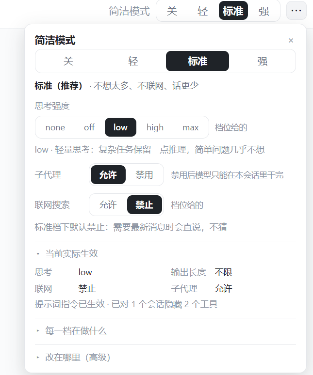

English | [中文](README.md)

# dsh-terse-mode — think less, search less, talk less



Answers that restate the question first, a simple task that still thinks for a minute, a question that pulls in a web search, a subagent spawned for something you could have asked in one line — that is the default level being eager.

This plugin adds four levels to the conversation header. It ships on **Standard**: less thinking, no web search, shorter answers. Press **Off** and it is as if it were not installed.

```sh
dsh plugin --profile desktop add dsh-terse-mode   # desktop app
dsh plugin --profile web add dsh-terse-mode       # dsh web
```

Reload the page once after installing; no configuration, no restart.

| You want | Pick |
|---|---|
| Just stop the rambling | **Light** — reasoning one notch down, search stays on |
| Everyday questions, no searching (default) | **Standard** — less thinking, no search, shorter |
| The shortest answer, as fast as possible | **Strong** — barely thinks, no search, shortest |
| Back to stock behaviour | **Off** — as if it were not installed |

Three switches (reasoning effort / web search / subagents) and an **Advanced** block (answer cap, custom instruction, apply to every model) live in the `⋯` popover and in Settings, over one shared state — change either place and the other follows.

## What it does

- **Thinks less** — pins the request's reasoning effort to the level's value, so a simple question stops taking a minute.
- **Searches less** — at Standard and Strong, `web_search` / `web_fetch` are removed from the model's tool list and refused if it calls them anyway.
- **Talks less** — one line at the end of the system prompt: answer directly, do not restate, do not summarise yourself. **No hard output limit.**
- **Delegates less** — `subagent`, `subagent_fork`, `spawn_teammate` and `workflow` can be hidden from the model and refused at call time.

## Levels

| Level | Reasoning effort | Output cap | Web search | For |
|---|---|---|---|---|
| `off` | untouched | none | allowed | disable the plugin |
| `light` | pinned to `low` | none | allowed | just stop the rambling |
| `standard` (default) | pinned to `low` | none | disabled | everyday questions |
| `strong` | `off` | none | disabled | fastest short answer |

**A level only supplies defaults.** Anything you set by hand stays: switching levels never clears an explicit effort or search choice. The subagent switch is independent of the level entirely.

## Reasoning effort (overrides the level)

The level's effort is a cap (it only lowers). To name an effort outright, use the panel or Settings.

| Option | Meaning |
|---|---|
| `none` | the request is never touched — whatever the model menu sends |
| `off` | thinking disabled — the fastest |
| `low` | light reasoning; enough for daily work |
| `high` | the model's high effort, above what the levels give |
| `max` | maximum effort: slowest and most expensive |

The chosen effort **is** the decision: pick `high` and the request goes out at `high` even if the model menu says otherwise — but only where the route advertises that effort, so an unsupported value can never fail the request.

There is no `auto` button. The switch shows the value **in effect**, so a level click visibly moves it (Strong → search "disabled", Light → "allowed"). The tag beside it says which layer decided:

- `from the level` — nobody pinned it;
- `yours`, with a "follow the level again" link — you picked it;
- `fixed by config` — `cordis.patch.yml` pins it, so no link is offered: clearing the pin would only let the same value back in.

## Web search and subagents

- **Search disabled** — `web_search` / `web_fetch` disappear from the model's tool list, and a real call is refused with "say you cannot look it up, do not guess". The cost is real: it cannot check current facts. Allow it, or switch to Light, when you need that.
- **Subagents disabled** — the four delegation tools disappear from the model's view. Cheaper per task and harder to lose control of; the price is no parallel fan-out on big jobs.

## Settings and Advanced

Settings → **Terse mode** has the same state as the header, in a roomier layout: four level cards (Standard is marked *recommended*), the three switches with their source tags, an *in effect* card, and a folded **Advanced** block:

- **Answer cap** — follow the level / unlimited / a custom positive integer;
- **Custom instruction** — the level's own wording, none, or a paragraph of your own (up to 4000 characters);
- **Apply to every model** — by default only DeepSeek routes are clamped.

*In effect* also reports what is really mounted, not what the policy wishes: whether the prompt section registered, how many tools are hidden, and how many sessions the deny list reached. "Installed but not doing anything" is visible instead of log-only.

## Panel details

- Clicking a level applies immediately — no file edit, no restart.
- Hovering `⋯` prints the four effective values, so you can check the switches without opening it.
- Choices are stored in `$DSH_HOME/storages/dsh-terse-mode/level.json` and survive restarts. The panel's layer wins over `cordis.patch.yml`; delete the file to fall back to the config.
- The popover is `position: fixed` under the button: the header row is not the plugin's, and an absolutely positioned box would be clipped.
- If the panel cannot reach the host it shows "host not connected" — usually a fresh plugin update that still needs one restart.

Panel and host talk over the host's own route, `GET/POST /dsh-terse-mode/api/state` (loopback only):

```sh
curl http://127.0.0.1:19387/dsh-terse-mode/api/state
curl -X POST -H 'content-type: application/json' -d '{"level":"strong"}' http://127.0.0.1:19387/dsh-terse-mode/api/state

# advanced knobs use the same route: maxTokens 0=follow the level / -1=unlimited / positive; instruction auto|none|text
curl -X POST -H 'content-type: application/json' -d '{"maxTokens":4096,"applyToAllModels":true}' http://127.0.0.1:19387/dsh-terse-mode/api/state
```

`GET` also returns `sources` (who decided each value: `panel` / `patch` / `level`) and `health` (is the prompt section really mounted, how many sessions got the deny list).

## Measured effect (this machine, desktop profile, same session)

| | Before | After |
|---|---|---|
| Reasoning effort | `high` | `low` |
| Per-reply output cap | `256000` (adapter default) | **none** (no level sets one) |
| Tool list | includes `web_search`, `web_fetch` | neither appears |

## Safety

- **A malformed config cannot stop DSH from booting** — unrecognised values fall back to safe defaults and leave one line in the log.
- **No effort is forced onto a model that does not support it** — only the request's existing effort is adjusted, and by default only on DeepSeek routes.
- **Tool hiding is belt and braces** — `tools.guard()` refuses the call for every session; `tools.restrict()` keeps the tool out of new sessions. An unknown tool name is swallowed and logged, never turned into a failed agent.
- **The state route is same-origin only** — it rejects a non-loopback `Host` (DNS rebinding), a cross-site `Origin` / `Sec-Fetch-Site`, and a POST without `content-type: application/json`. A random page on this machine cannot flip your level to `off`.
- **Zero runtime dependencies** — plain JavaScript, no packages, no `node_modules`.

## Known limits

- **No hard truncation** — briefness is asked for, not enforced. Want a ceiling? Set `maxTokens` explicitly.
- **With search disabled, "search for it" does not work** — allow search or switch to Light when you need it.
- **It applies to every session in the profile**, subagents included; `off` is the master switch.
- **Code changes need a restart; config changes do not.**
- **Diagnostic noise**: the config validator is hand-written and dependency-free, so `dsh --dump-config-schema` adds one `Config is not a native Schemastery schema` line. It does not affect startup.

## Install / uninstall (script)

```sh
# status, dry run
node tools/install-terse-mode.mjs --status
node tools/install-terse-mode.mjs --dry-run

# install (standard by default)
node tools/install-terse-mode.mjs
node tools/install-terse-mode.mjs --profile desktop --level light

# uninstall (backs up the profile manifest and patch first)
node tools/install-terse-mode.mjs --uninstall
```

It touches four places in the profile: one `link:` dependency, one `node_modules` junction, one marked `insert` row in the profile's own `cordis.patch.yml` (non-desktop profiles also get `dsh.profile.bundles`). No pnpm, no lockfile, no effect on other plugins.

## Development

```sh
# from the repository root
npm test                             # the whole suite (node --test test/*.test.mjs)

node --test test/logic.test.mjs      # levels and clamping
node --test test/plugin.test.mjs     # apply() wiring, against a fake Cordis context
node --test test/level-api.test.mjs  # the state route and its same-origin checks
node --test test/client.test.mjs     # both views actually render
```

CI (`.github/workflows/test.yml`) runs the suite on Node 20 / 22 / 24 for every push to `main` and every PR.

Design notes: [`docs/design.md`](docs/design.md).
