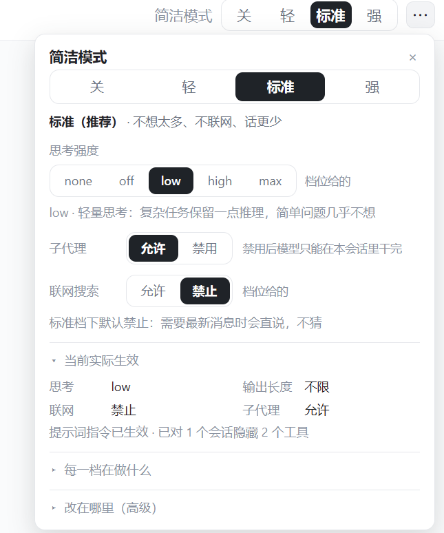

# dsh-terse-mode — 少想、少搜、少废话



回答开头先复述一遍问题、简单问题也要想很久、随口一问就联网搜、动不动派子代理烧 token —— 这些都是默认档位太“殷勤”。

这个插件在对话页顶栏加一排四档开关，**装上默认就是「标准」**：不想太多、不联网、话更短。点「关」即恢复原样。

```sh
dsh plugin --profile desktop add dsh-terse-mode   # 桌面端
dsh plugin --profile web add dsh-terse-mode       # 网页端
```

装完刷新一次页面即生效，不用配置、不用重启。

| 你想要 | 选哪一档 |
|---|---|
| 只是嫌它啰嗦 | **轻** — 思考压一档，联网照常 |
| 日常问答，别乱搜（默认） | **标准** — 不想太多、不联网、话更少 |
| 只要最短答案，越快越好 | **强** — 几乎不想、不联网、答案压到最短 |
| 完全恢复原样 | **关** — 跟没装一样 |

三个开关（思考强度 / 联网搜索 / 子代理）和「高级」区（输出上限、自定义提示词、对所有模型生效）
都在 `⋯` 弹层和设置页里，两处是同一份状态，改哪边都立即生效。

它具体做了四件事：

- **少想**：把模型请求的推理强度压到档位值，简单问题不再想很久；
- **少搜**：`web_search` / `web_fetch` 按档位或开关关闭——新会话里模型根本看不到这两个工具，老会话里真调用也会被拒绝；
- **少废话**：系统提示词最后加一条「直接答、别复述、别总结自己」的指令，**不设硬性输出上限**，回答长度只由指令引导；
- **少委派**：可一键禁用子代理（`subagent` / `subagent_fork` / `spawn_teammate` / `workflow` 四个工具从模型眼前隐藏）。

> 走源码安装（脚本方式，改完立即生效，适合本地开发）：
> `node tools/install-terse-mode.mjs --profile web`，详见下文「安装 / 卸载」。

## 档位

| 档位 | 思考强度 | 单次输出上限 | 联网搜索 | 适合 |
|---|---|---|---|---|
| `off` | 不动 | 不限 | 允许 | 关掉插件（总开关） |
| `light` | 压到 `low` | 不限 | 允许 | 只想让它别啰嗦 |
| `standard`（默认） | 压到 `low` | 不限 | 禁止 | 日常问答 |
| `strong` | 关到 `off` | 不限 | 禁止 | 只想快速得到短答案 |

**四个档位都不设输出上限**：回答长度只由提示词指令引导，不会被硬截断。想给某次会话硬上限，才显式写 `maxTokens: <正整数>`。

**档位只提供默认值**：没手动改过的项跟着档位走，改过的项会一直保留，右侧标记会说明这一项由谁决定；换档位不会清掉你调过的值。子代理开关完全独立于档位。所以上表的「思考强度 / 联网搜索」两列读作「该档位的默认值」。

## 思考强度（可单独调）

档位给的思考强度是**上限**（只降不升）；想直接指定强度，用顶部控件或设置页里的「思考强度（覆盖档位）」。
文案与官方模型菜单一致，用官方的 effort 名：

| 选项 | 含义 |
|---|---|
| `auto`（跟随档位） | 由档位决定：light / standard = `low`，strong = `off`，off（档位）= 完全不碰请求 |
| `off` | 完全关闭思考（最快） |
| `low` | 轻量思考 |
| `high` | 比档位更高——只给确实需要深思的任务 |
| `max` | 最大强度，最慢最贵 |

- 面板里**没有 `auto` 这个按钮**：开关显示的是当前生效值，切档位时自动跳到该档对应的位置；右边标记是 `档位给的` 时表示这一项由档位决定，点「改为跟随档位」才写回 `auto`。
- **点了就是决定，不是上限**：选 `high` 会把请求强度设成 `high`（即使模型菜单里选的是低）；只有该模型确实公布了这个强度时才设，否则保持原样。
- **档位只提供默认值，不会覆盖你手动设的项**：先点档位、再调思考强度/联网，两者互不影响；换档位也不会把你调过的值清掉。
- 面板选择（档位 + 强度 + 联网 + 子代理）都记在 `$DSH_HOME/storages/dsh-terse-mode/level.json`。
- 命令行等价写法：POST `/dsh-terse-mode/api/state`，body `{"reasoningEffort":"high"}`（或 `{"level":"light","search":"allow"}`）。
- patch 里也可以写：`reasoningEffort: auto | none | off | low | high | max`（`auto` 跟随档位，`none` 从不碰请求）。


细项可以覆盖档位（写在 `cordis.patch.yml` 那一行的 `config` 里）：

```yaml
- id: terse-mode
  config:
    level: standard
    reasoningEffort: auto     # auto | none | off | low | high | max
    maxTokens: 0              # 0=跟随档位, -1=不限, 或正整数
    search: auto              # auto | allow | deny（面板里有开关，auto=跟随档位）
    subagents: allow          # allow | deny（也可写 true/false）
    subagentTools:            # 可选：覆盖被隐藏的工具名单
      - subagent
    instruction: auto         # auto | none | 你自己的提示词
    applyToAllModels: false   # true=对非 DeepSeek 模型也压强度
```

## 联网搜索开关

和档位**互相独立**的另一个开关，在 `⋯` 弹层的「联网搜索」一节里：
**允许 / 禁止** 两个按钮，显示的是当前生效值（换档位会自己跳过去），右边标明是谁定的：

```
简洁模式   [关][轻][标准][强]   (⋯)
```

- 禁止做的事：`web_search` / `web_fetch` **从模型眼前隐藏**，运行期也硬拦（guard 消息「Web tools are turned off…」），
  并在系统提示里加一句「联网已关，需要外部事实就直说，不要猜」。
- 允许做的事：即使当前档位是「标准/强」（默认禁止联网），也会放行联网工具。
- `auto` 让你随时回到「由档位决定」：`关/轻` 允许，`标准/强` 禁止。
- 手动选过之后，这项右边会变成「改为跟随档位」——点它即交还给档位（等价于写回 `auto`）。
- 这个显式选择和思考强度一样，**换档位不会清掉**。
- 不依赖联网的外部事实无法获得时，模型会明说而不是编造 —— 这是禁止联网的预期代价。
- 顶部看不到这个状态，只把鼠标停在 `⋯` 上：提示里会写当前生效值。

## 禁用子代理

和另外两个开关一样**独立于档位**（不跟着档位变、改档位也不会动它），同样在 `⋯` 弹层里：

```
简洁模式   [关][轻][标准][强]   (⋯)
```

「子代理」一节里选「允许 / 禁用」。禁用做的事：
把**四个创建子代理的工具**（`subagent`、`subagent_fork`、`spawn_teammate`、`workflow`）从模型眼前隐藏，并在运行期硬拦它们的调用
（guard 的消息是「Subagents are turned off…」）。团队记账类工具（`team_task_*` 等）不动：没有创建入口它们本身做不了事。
要自定义名单就写 `subagentTools`。默认 `allow`，不改变原有行为。

## 在设置页面里调

除了对话页顶部的小控件，**DSH 设置页里也有一节「简洁模式」**（客户端插件注册 `settings.section` 槽），里面有：
四张档位卡片（一行说清一档，带「推荐」标记，整行可点）、三个独立开关、一张「当前实际生效」卡片（含健康状态）、
以及折叠的「高级」—— 在那一区里可以直接改**输出上限**（跟随档位 / 不限 / 自定义数字）、
**自定义提示词**（默认 / 关闭 / 自己写一段）、**是否对所有模型生效**，并列出被隐藏的工具、`level.json` 与 patch 的位置。
这些项以前只能编辑 YAML，现在面板和 YAML 改的是同一份状态（面板优先，删掉 `level.json` 即回到 YAML）。
两处是**同一份状态**：在设置页里改，顶部控件立刻跟着变，反之亦然。

## 两个部署（桌面端 + 网页端）

插件装在 **profile** 里，桌面端和网页端用的是不同 profile，所以要各装一次：

```bash
node tools/install-terse-mode.mjs                    # 桌面端（profiles/desktop）
node tools/install-terse-mode.mjs --profile web      # 网页端（dsh web 用的 profiles/web）
```

`--profile <名字>` 对应 `$DSH_HOME/profiles/<名字>`；`--status` 看当前状态，`--uninstall` 撤销（都要带同一个 `--profile`）。
两端共用同一个记忆文件 `$DSH_HOME/storages/dsh-terse-mode/level.json`，所以档位/强度/子代理选择是共享的 —— 并且是**运行时就同步**的：
插件监听这个文件，一端改了，另一端 150ms 内跟上，不用重启。

改档位有两种办法，任选：

1. 在插件目录里执行 `node tools/install-terse-mode.mjs --level strong`（改的是插件自带的 patch）；
2. 在你 profile 的 `cordis.patch.yml` 里按 `id: terse-mode-profile` 覆盖安装脚本插进去的那一行 —— 这一层优先级最高，升级插件也不会丢，
   而且改 profile 的 patch 是**热生效**的（约 1 秒），不用重启。
   （插件自带的 bundle patch 里那一行 id 是 `terse-mode`；profile 里的是 `terse-mode-profile`，两者不要混。）

> 注意区分：改**配置**（档位/细项）是热生效的；改**插件代码**（`index.js`/`lib/`/`client.js`）需要重启一次 DSH 才换用新模块，
> 因为已安装的模块不会重新导入（实测：加一条注释触发 profile 重组合后，新路由仍然 404）。新增 client 半侧同样需要重启。

面板里点档位则**不需要**重启：那是运行时改策略，不走模块加载。
## 可视化面板

对话页**顶部那一行**（「智能体团队 / 标准模式」旁边）有一个常驻控件：

```
简洁模式   [关][轻][标准][强]   (⋯)
```

- 点一下档位就立即生效，不用改文件、不用重启：提示词、思考强度、输出上限、联网搜索一起跟着变。
  当前档位是**实心深色块**（和宿主自己的分段控件同一套做法），一眼能看到；四格等宽，选中块不会随字数跳动。
- **每个档位鼠标移上去都有说明**（原生提示，一句话说清这一档压什么、放什么）。
- **`⋯`** 打开面板（原来行上的 `子代理`、`联网`、`?` 都收进这里，顶行只留一个入口）。顺序是「先能操作，再看解释」：
  - 最上面又是四档（**这里的档位可以直接点**），下面一行写当前档和一句话摘要；
  - 「思考强度」：`none / off / low / high / max`；「联网搜索」：`允许 / 禁止`。**开关显示的是当前生效值**，
    点档位时它会自动跳到该档对应的位置（强 → 联网「禁止」、轻 → 「允许」）；后面跟着一枚来源标记：
    `档位给的`（没手动改过）、`改为跟随档位`（你改过，点它交还给档位）、`配置文件固定`（patch 写死的）；
  - 「子代理」：`允许 / 禁用`，附一句当前含义；
  - 折叠区「当前实际生效」：思考 / 输出上限 / 联网 / 子代理，外加**真实健康状态**（提示词有没有注入、藏了几个工具）；
  - 折叠区「每一档在做什么」：四档逐条解释；
  - 折叠区「改在哪里（高级）」：细项在 `cordis.patch.yml`；面板的选择存在
    `$DSH_HOME/storages/dsh-terse-mode/level.json`，优先于 patch，删掉即回到 patch；改配置立即生效，改代码要重启。
- 面板会说明每个值**来自哪一层**：`档位给的` / `改为跟随档位`（你定的）/ `配置文件固定`。
  patch 写死的项不给「改为跟随档位」的入口 —— 清了 pin 值也会立刻被 patch 弹回来，那个按钮等于假的。
  这也解释了为什么档位「关」在有 patch 覆盖时并不等于"完全不限制"。
- `⋯` 的 hover 提示会写出「思考 / 上限 / 联网 / 子代理」四项的当前生效值 —— 顶行不显示开关状态，这是不打开面板也能核对的地方。
- 弹层用 `position: fixed` 挂在按钮下方：顶部那一行不归插件管，绝对定位的盒子可能被裁掉。
- 选择会记住（存到 `$DSH_HOME/storages/dsh-terse-mode/level.json`）。**面板选的优先于 patch**，
  但两层是分开记的：点「改为跟随档位」只是清掉**面板自己**那一项，patch 里写死的 `reasoningEffort` / `search` 会立刻回来，
  不会被一次点击永久抹掉。想连 patch 的值一起回到默认，改 patch 或删掉那个文件。
- 面板没连上宿主时按钮右边会显示红字「未连上宿主」（通常是插件刚更新，还需要重启一次 DSH）。
- 写不进 `level.json` 时（只读目录、磁盘满）选项目前仍然生效，但日志里会留一条 warning：
  `plugin.log` 与 `dsh-terse-mode` 的 logger 都能看到，重启会丢。

面板与宿主之间走的是 DSH 自己的 HTTP 路由：`GET/POST /dsh-terse-mode/api/state`（仅回环，
和插件市场 `/dsh-market/*` 同一个通道）。手工核对：

```sh
curl http://127.0.0.1:19387/dsh-terse-mode/api/state
curl -X POST -H 'content-type: application/json' -d '{"level":"strong"}' http://127.0.0.1:19387/dsh-terse-mode/api/state

# 高级项走同一条路由：maxTokens 0=跟随档位 / -1=不限 / 正整数；instruction auto|none|文本
curl -X POST -H 'content-type: application/json' -d '{"maxTokens":4096,"applyToAllModels":true}' http://127.0.0.1:19387/dsh-terse-mode/api/state
curl -X POST -H 'content-type: application/json' -d '{"instruction":"Answer in one sentence."}' http://127.0.0.1:19387/dsh-terse-mode/api/state
```

`GET` 里还会带两项供面板显示：`sources`（每个值来自 `panel` / `patch` / `level`）与
`health`（提示词 section 是否真的挂上、deny 名单生效在几个会话上）—— 插件“看起来在跑其实没生效”时，先看这里。

## 实测效果（本机 desktop profile，同一个会话）

| | 装之前 | 装之后 |
|---|---|---|
| 推理强度 | `high` | `low` |
| 单次输出上限 | `256000`（适配器默认） | **不限**（档位不再设上限） |
| 工具表 | 含 `web_search`、`web_fetch` | 两者都不再出现 |

`http://127.0.0.1:19387/dsh-market/installed` 里显示 `dsh-terse-mode: state=live`、`findings: []`。

## 安全设计（为什么它不会把你搞崩）

- **配置写错不会让插件启动失败**：插件的配置校验器永不报错，认不出的值一律回落到安全默认，并在日志里留一条 warning。
  （本机曾因插件启动失败触发过 Desktop 安全模式，把 profile 的 bundles 砍回 in-box，所以这里必须这么设计。）
- **绝不强行给不支持思考的模型加推理强度**：只有请求本身已经带了 `reasoningEffort` 时才压，而且只降不升、只认 `off/low/high/max` 这组 DeepSeek 的取值。
  默认只对 provider 以 `deepseek` 开头的路由生效，`applyToAllModels: true` 才放开。
- **工具禁用是双保险**：`tools.guard()` 让调用必定失败（对所有会话立即生效），`tools.restrict()` 让新会话的模型看不到这两个工具。
  `restrict` 在报「未知工具名」时会被吞掉并记日志，绝不让 agent 创建失败。
- **面板路由只认同源**：`/dsh-terse-mode/api/state` 拒绝跨站 `Origin`、`Sec-Fetch-Site: cross-site` 和非回环 `Host`
  （DNS rebinding），POST 还要求显式 `content-type: application/json`；桌面端 shell 转发时这些头都缺失，仍然放行。
  这样本机任意网页无法再用一个 `no-cors` 表单把档位静默切到 `off`。
- **零运行时依赖**：纯 JS，不 import 任何 DSH 包，也不带 node_modules。

## 已知边界（先说清楚）

- **输出不再有硬截断**：四个档位都不设 `maxTokens`，长回答不会被切断；长度只由提示词指令引导。若你想要硬上限，显式写 `maxTokens: <正整数>`（插件只会在模型/路由已有的值上取更小的那个）。
- **禁止搜索后，你明确说「搜一下」也搜不了**。要搜就把 `search` 设成 `allow`（或整个切到 `light`/`off`）。
- **「让模型看不到工具」在装上的那一刻就对已开会话生效**（插件会扫一遍在跑的 agent）；靠 guard 兜底的拒绝路径由单测覆盖。
- **对所有会话生效**，包括子 agent；没有「只对这个会话」的开关（`off` 档就是总开关）。
- **改代码要重启**，改配置是热生效（见上）。
- **诊断噪音**：本插件的配置校验是零依赖手写实现（`link:` 安装的插件解析不到 `@deepseek-ai/*`），
  所以 `dsh --dump-config-schema` 会对本行多报一条 `Config is not a native Schemastery schema`。
  这条命令不参与启动，插件运行不受影响。

## 安装 / 卸载

```sh
# 看当前状态
node tools/install-terse-mode.mjs --status

# 只预演，不写文件
node tools/install-terse-mode.mjs --dry-run

# 安装（默认 standard 档）
node tools/install-terse-mode.mjs
node tools/install-terse-mode.mjs --profile desktop --level light

# 卸载（会先把 profile 清单与 patch 备份到 工作区/.backup/<时间戳>/）
node tools/install-terse-mode.mjs --uninstall
```

安装只动 profile 这四处：`package.json` 里一条 `link:` 依赖、`node_modules/dsh-terse-mode` 这个 junction、
**profile 自己的 `cordis.patch.yml` 里一行带标记的 `insert`**（非 desktop profile 还会补 `dsh.profile.bundles`）。
不跑 pnpm、不动 lockfile，所以其他已装插件不会受影响；卸载时全部还原。

**为什么不靠 `dsh.profile.bundles`**：2026-10-01 12:29 实测，Desktop 宿主启动时重写了 desktop profile 的 `package.json`，
把 `dsh-terse-mode` 从 `dsh.profile.bundles` 里删掉了（依赖条目还在，market 日志与 plugin-manager 都没有对应操作），
插件于是在下一次启动时不再挂载。profile 的 `cordis.patch.yml` 是用户层，宿主只做外科式改动、保留它 —— 把行插在那里才是稳的。
`name: dsh-terse-mode` 由 profile 的 `node_modules`（junction）解析，与 bundles 无关。标记注释 `>>> dsh-terse-mode >>>` / `<<<` 让改档位与卸载都能精确替换那一段。

> 实测补充：**改宿主模块代码（`index.js` / `lib/`）必须重启一次 DSH**。即便把 profile patch 里那一行删掉再插回来（重新挂载一次），
> 宿主仍然复用内存里的旧模块（三个档位 POST 后 effective 值完全一致，即可判定跑的还是旧代码）。改配置/点档位不需要重启。

## 开发

```sh
# 在仓库根目录执行；从别处进来先 cd 到 clone 下来的目录
npm test                             # 全部用例（node --test test/*.test.mjs）

node --test test/logic.test.mjs      # 档位与钳制规则
node --test test/plugin.test.mjs     # apply() 的接线（用一个假 Cordis context）
node --test test/level-api.test.mjs  # 面板路由与同源校验
node --test test/client.test.mjs     # 两个界面真的渲染一遍
```

> `node --test test/` 这种只给目录的写法在 Windows + Node 24 上会报 `MODULE_NOT_FOUND`，要用上面的 glob 或 `npm test`。

设计说明与取舍见 [`../docs/superpowers/specs/2026-10-01-terse-mode-design.md`](../docs/superpowers/specs/2026-10-01-terse-mode-design.md)。
